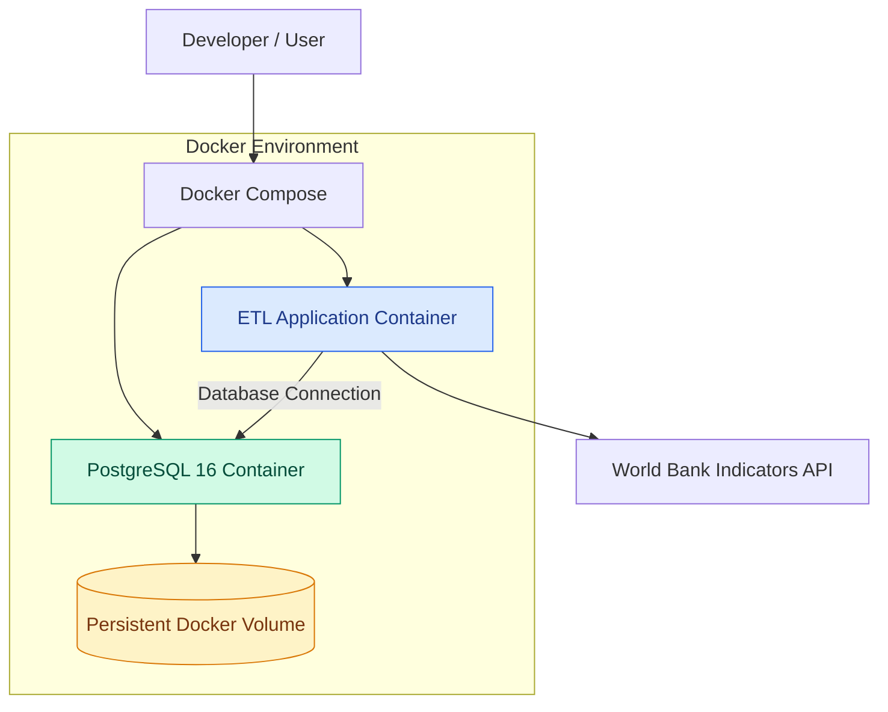
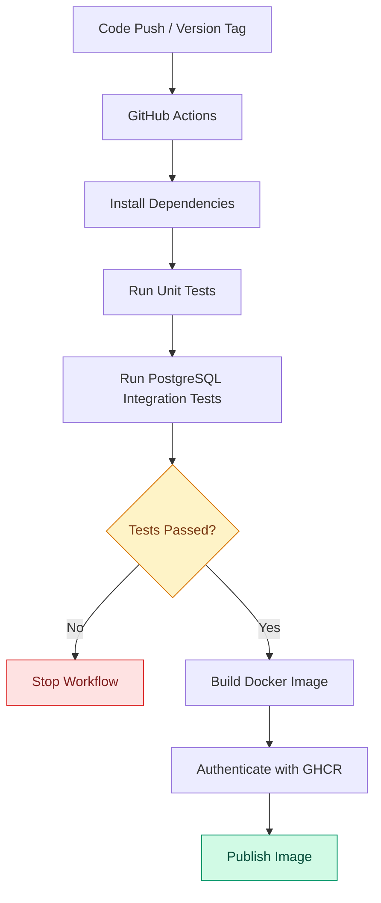

# Deployment Guide

## 1. Overview

The World Bank Data ETL Pipeline is containerized using Docker and Docker Compose to provide a consistent and reproducible execution environment.

The deployment consists of two primary services:

1. **PostgreSQL:** Stores the extracted and processed World Bank observations.
2. **ETL Application:** Executes the Python pipeline and loads validated records into PostgreSQL.

Docker Compose manages the application services, database connectivity, persistent storage, environment configuration and service dependencies.

The project also uses GitHub Actions to automate testing, Docker image building and publishing to GitHub Container Registry (GHCR).

## 2. Deployment Architecture



## 3. Prerequisites

Install the following tools before running the application:

| Requirement | Purpose |
|---|---|
| Docker Desktop | Runs Docker containers |
| Docker Compose | Manages application services |
| Git | Repository management |
| Python 3.10 | Local application execution |
| GitHub account | Source code and container registry |

Verify Docker installation:

```powershell
docker --version
docker compose version
```

Verify that Docker Desktop is running:

```powershell
docker info
```

## 4. Project Configuration

The application uses environment variables to configure API extraction, database connectivity, logging and batch loading.

A sample configuration file is provided as:

`.env.example`

### 4.1 Create the environment file

From the project root:

```powershell
Copy-Item .env.example .env
```

Update `.env` with your local configuration.

### 4.2 Application configuration

The main configuration groups are:

| Configuration | Purpose |
|---|---|
| `WB_BASE_URL` | World Bank API base URL |
| `WB_COUNTRY` | Country code |
| `WB_INDICATOR` | Indicator code |
| `WB_START_YEAR` | Historical extraction start year |
| `WB_END_YEAR` | Historical extraction end year |
| `WB_PAGE_SIZE` | API page size |
| `WB_TIMEOUT_SECONDS` | HTTP request timeout |
| `WB_MAX_RETRIES` | Maximum retry attempts |
| `WB_BACKOFF_FACTOR` | Retry backoff configuration |
| `APP_ENV` | Application environment |
| `LOG_LEVEL` | Logging level |

### 4.3 Database configuration

| Configuration | Purpose |
|---|---|
| `DB_HOST` | Database hostname |
| `DB_PORT` | Database port |
| `DB_NAME` | Database name |
| `DB_USER` | Database username |
| `DB_PASSWORD` | Database password |
| `DB_SCHEMA` | Target database schema |
| `DB_TABLE` | Target observation table |
| `DB_BATCH_SIZE` | Batch loading size |

For Docker Compose, the ETL application connects to PostgreSQL using the service hostname `postgres` and the container port `5432`.

Do not commit `.env` or expose database credentials in the GitHub repository.

## 5. Dockerfile

The Dockerfile defines the runtime environment for the Python ETL application.

The project uses the official Python 3.10 slim image as its base image.

### 5.1 Build configuration

The Dockerfile performs the following operations:

1. Selects Python 3.10 slim as the base image.
2. Configures Python environment variables.
3. Sets `/app` as the working directory.
4. Copies `requirements.txt`.
5. Installs application dependencies.
6. Copies the Python source code.
7. Creates a non-root application user.
8. Runs the application as that user.

### 5.2 Runtime execution

The container executes:

```bash
python -m worldbank_etl.pipeline
```

The Python source directory is configured through:

```text
PYTHONPATH=/app/src
```

The application runs as a non-root user to reduce unnecessary container privileges.

## 6. Docker Compose Configuration

The `docker-compose.yml` file defines the PostgreSQL and ETL services.

### 6.1 PostgreSQL service

The database service uses:

```text
postgres:16
```

Key configuration:

- Database credentials are supplied through environment variables.
- Host port `5433` maps to container port `5432`.
- A named Docker volume provides persistent database storage.
- The SQL schema is mounted into PostgreSQL's initialization directory.
- A health check verifies database readiness.

The health check uses `pg_isready` to determine when PostgreSQL is ready to accept connections.

### 6.2 ETL application service

The ETL service:

- Builds the image from the project Dockerfile.
- Loads application configuration from `.env`.
- Uses `postgres` as its database hostname.
- Connects to PostgreSQL on port `5432`.
- Waits for the PostgreSQL service to become healthy.
- Executes the Python ETL pipeline.

### 6.3 Database persistence

Docker Compose defines a named volume:

```text
postgres_data
```

This volume stores PostgreSQL data independently of the lifecycle of the application container.

Stopping or removing containers without removing the volume preserves the database contents.

## 7. Running the Application

### 7.1 Clone the repository

```powershell
git clone https://github.com/Punam-Naik/worldbank-etl.git
cd worldbank-etl
```

### 7.2 Configure environment variables

```powershell
Copy-Item .env.example .env
```

Update `.env` with your database credentials and application settings.

### 7.3 Build and start services

```powershell
docker compose up --build
```

This command builds the ETL image, starts PostgreSQL, waits for the database health check and executes the ETL application.

### 7.4 Run services in the background

```powershell
docker compose up --build -d
```

### 7.5 Check running containers

```powershell
docker compose ps
```

### 7.6 View application logs

```powershell
docker compose logs etl
```

View PostgreSQL logs:

```powershell
docker compose logs postgres
```

Follow application logs:

```powershell
docker compose logs -f etl
```

### 7.7 Stop the services

```powershell
docker compose down
```

This stops and removes the containers and network but preserves the named PostgreSQL volume.

**Important:** Avoid `docker compose down -v` unless you intentionally want to delete the persistent database volume and its contents.

## 8. PostgreSQL Database Access

The PostgreSQL service is accessible through two different connection configurations.

| Connection source | Host | Port |
|---|---|---|
| Host machine | `localhost` | `5433` |
| ETL container | `postgres` | `5432` |

The distinction is important:

- Local Python scripts connect through `localhost:5433`.
- The ETL application container connects through `postgres:5432`.

The PostgreSQL database can be accessed using `psql`, pgAdmin or another PostgreSQL client.

Example query:

```sql
SELECT
    country_code,
    indicator_code,
    year,
    value
FROM public.world_bank_observations
ORDER BY year;
```

## 9. Docker Image Publishing

The project uses GitHub Container Registry (GHCR) to store published Docker images.

Image repository:

```text
ghcr.io/punam-naik/worldbank-etl
```

### 9.1 Pull the published image

```powershell
docker pull ghcr.io/punam-naik/worldbank-etl:latest
```

### 9.2 Verify the downloaded image

```powershell
docker images
```

### 9.3 Image publishing workflow

The GitHub Actions workflow automatically builds and publishes Docker images after successful tests.

Supported triggers:

- Push to the `main` branch.
- Push of version tags matching `v*`.

Pull requests run tests and build the image without publishing it.

The workflow uses GitHub Actions' `GITHUB_TOKEN` for GHCR authentication.

### 9.4 Container registry access

If the package is public, it can be pulled without authentication.

For a private package, authenticate first:

```powershell
docker login ghcr.io -u YOUR_GITHUB_USERNAME
```

Use a GitHub token with the required package read permission when prompted. Never commit the token to the repository.

## 10. CI/CD Deployment Workflow



The publishing stage only runs after the test stage succeeds and is skipped for pull requests.

## 11. Deployment Considerations

### Configuration security

- Keep `.env` out of version control.
- Use separate credentials for development and CI.
- Avoid embedding passwords in Dockerfiles.
- Use GitHub-managed tokens for registry authentication.

### Persistent storage

- PostgreSQL data is stored in a named Docker volume.
- Container recreation does not automatically remove database data.
- Database backups should be taken before destructive maintenance operations.

### Database initialization

The SQL schema is mounted into PostgreSQL's initialization directory.

PostgreSQL executes initialization scripts when the database data directory is first initialized. Changing the SQL file does not automatically apply the changes to an already initialized database volume.

Schema changes on an existing database must be applied explicitly.

### Application lifecycle

The ETL application is configured as a batch process. Its container exits after the pipeline completes.

For a subsequent execution, start the ETL service again using Docker Compose.

## 12. Summary

The deployment architecture uses Docker and Docker Compose to provide a reproducible environment for the Python ETL application and PostgreSQL database.

GitHub Actions automates testing, image building and publishing to GHCR.

The resulting setup demonstrates:

- Containerized Python application deployment.
- PostgreSQL container management.
- Persistent database storage.
- Environment-based configuration.
- Container health checks and service dependencies.
- Automated Docker image building.
- Container registry publishing through CI/CD.