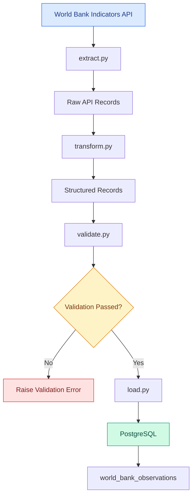

# ETL Workflow

## 1. Overview

The World Bank Data ETL Pipeline uses a modular Python architecture to extract historical population observations from the World Bank Indicators API, transform the API response into a structured format, validate the records, and load them into PostgreSQL.

The pipeline separates each ETL responsibility into an independent Python module:

| Module | Responsibility |
|---|---|
| `extract.py` | API requests, pagination, retries and extraction |
| `transform.py` | Flattening and normalization of API responses |
| `validate.py` | Data quality and integrity checks |
| `load.py` | PostgreSQL batch inserts and UPSERT operations |
| `pipeline.py` | Orchestration of the complete ETL workflow |

## 2. ETL Architecture



## 3. Extraction – `extract.py`

The extraction module communicates with the World Bank Indicators API and retrieves all available observation pages for the configured country, indicator and historical period.

### 3.1 Endpoint construction

The `build_url()` function dynamically constructs the API endpoint using application settings.

The endpoint follows this structure:

```text
{base_url}/country/{country_code}/indicator/{indicator_code}
```

For the current project:

```text
https://api.worldbank.org/v2/country/IND/indicator/SP.POP.TOTL
```

### 3.2 HTTP session and retry handling

The `create_http_session()` function creates a reusable Requests HTTP session.

It configures:

- Configurable retry attempts.
- Connection, read and HTTP status retries.
- Exponential backoff through the configured backoff factor.
- Retry handling for HTTP 429, 500, 502, 503 and 504.
- GET requests as the permitted retry method.
- Respect for the server's `Retry-After` header.
- JSON response headers and a custom User-Agent.

The configured request timeout is passed to each API request.

### 3.3 Fetching an API page

The `fetch_page()` function:

1. Sends an HTTP GET request.
2. Checks the HTTP response status.
3. Parses the JSON response.
4. Verifies the expected two-element World Bank API response structure.
5. Separates API metadata from observation records.
6. Handles a null records section as an empty list.
7. Returns metadata and records separately.

### 3.4 Pagination

The `extract_all_pages()` function manages the complete extraction process.

The extraction sequence is:

1. Load application settings if they were not supplied.
2. Construct the API endpoint.
3. Configure query parameters, including date range and page size.
4. Fetch the first API page.
5. Read the total number of pages from the response metadata.
6. Iterate through the remaining pages.
7. Combine observations from all pages into one list.
8. Return the first page's metadata and the combined records.

The function also manages the HTTP session lifecycle, closing sessions that it creates itself.

### Extraction output

The extraction function returns:

- API metadata from the first response.
- A combined list of raw World Bank observation records.

## 4. Transformation – `transform.py`

The transformation module converts the nested World Bank API JSON response into a consistent, flat record structure suitable for PostgreSQL.

The main function is:

```python
transform_records(records)
```

### 4.1 Source API structure

A World Bank observation contains nested country and indicator information, along with the year and observation value.

Example:

```json
{
  "countryiso3code": "IND",
  "date": "2020",
  "country": {
    "value": "India"
  },
  "indicator": {
    "id": "SP.POP.TOTL",
    "value": "Population, total"
  },
  "value": 1380004385
}
```

### 4.2 Transformation operations

For each input record, the transformation function:

1. Retrieves the country information.
2. Retrieves the indicator information.
3. Extracts the observation year.
4. Extracts the observation value.
5. Converts the year into an integer.
6. Converts non-null values into floating-point numbers.
7. Preserves null observation values.
8. Produces a flattened dictionary.

A missing year raises a `ValueError`.

### 4.3 Target record structure

The resulting record contains:

| Field | Description |
|---|---|
| `country_code` | Three-letter country code |
| `country_name` | Country name |
| `indicator_code` | World Bank indicator code |
| `indicator_name` | Indicator description |
| `year` | Observation year as an integer |
| `value` | Numeric observation value or null |

The source and target grain is:

**Country + Indicator + Year**

The transformation function returns a list of structured records.

## 5. Validation – `validate.py`

The validation module checks the transformed records before they are loaded into PostgreSQL.

The main function is:

```python
validate_records(records)
```

It returns a tuple:

```python
(is_valid, errors)
```

### 5.1 Required field validation

The following fields must be present and non-null:

- `country_code`
- `country_name`
- `indicator_code`
- `indicator_name`
- `year`

The observation `value` is allowed to be null because the source may not provide an observation for a particular year.

### 5.2 Year validation

The observation year must fall within the range:

```text
1900 <= year <= 2100
```

### 5.3 Negative value validation

Negative observation values are rejected.

Null values are allowed.

### 5.4 Duplicate detection

The validation module maintains a set of previously encountered business keys.

The duplicate key consists of:

```text
country_code + indicator_code + year
```

If the same combination occurs more than once in the input records, a validation error is generated.

### 5.5 Validation result

The function returns:

- `True` and an empty error list when all records pass.
- `False` and a list of validation errors when one or more checks fail.

The pipeline stops before database loading if validation fails.

## 6. Loading – `load.py`

The loading module persists validated records into PostgreSQL.

The main function is:

```python
load_records(records, settings)
```

### 6.1 Empty input handling

If the input record list is empty, the loader logs a warning and returns zero without attempting a database insert.

### 6.2 Dynamic table identification

The loader uses `psycopg2.sql.Identifier` to safely compose the configured database schema and table identifiers.

This allows the schema and table names to be configured through application settings.

### 6.3 Batch loading

The loader uses:

```python
psycopg2.extras.execute_values
```

Records are converted into tuples and submitted through a batch insert operation.

The configured `db_batch_size` controls the page size used by `execute_values`.

### 6.4 UPSERT strategy

The loader uses PostgreSQL's:

```sql
ON CONFLICT (country_code, indicator_code, year)
DO UPDATE SET
    country_name = EXCLUDED.country_name,
    indicator_name = EXCLUDED.indicator_name,
    value = EXCLUDED.value,
    updated_at = CURRENT_TIMESTAMP
```

The composite conflict key ensures that the same country, indicator and year combination is not inserted more than once.

The loading behaviour is:

| Scenario | Database action |
|---|---|
| New observation | Insert a new row |
| Existing observation | Update the existing row |
| Updated indicator or country name | Update the corresponding metadata |
| Updated observation value | Update the existing value |
| Empty input | Return zero without loading |

### 6.5 Transaction management

The loader uses the `get_db_connection()` context manager from `database.py`.

The database connection context handles transaction commit on success, rollback on exception and connection closure.

The loader returns the number of records submitted for loading.

This count represents submitted records, not the number of newly inserted rows or updated rows.

## 7. Pipeline Orchestration – `pipeline.py`

The `pipeline.py` module acts as the entry point and coordinates the individual ETL components.

The main function is:

```python
run_pipeline()
```

### 7.1 Execution sequence

**Step 1 – Load configuration**

The pipeline loads application settings from the configured environment and initializes logging.

**Step 2 – Extract**

```python
metadata, raw_records = extract_all_pages(settings)
```

The extractor retrieves all available API pages and returns raw records.

**Step 3 – Transform**

```python
transformed_records = transform_records(raw_records)
```

The nested API response is flattened into structured records.

**Step 4 – Validate**

```python
is_valid, errors = validate_records(transformed_records)
```

The pipeline checks the transformed data.

If validation fails, the pipeline raises a `ValueError` containing the validation errors and does not proceed to loading.

**Step 5 – Load**

```python
loaded_count = load_records(
    transformed_records,
    settings
)
```

Validated records are submitted to PostgreSQL using batch loading and UPSERT.

**Step 6 – Generate execution summary**

After successful loading, the pipeline creates a summary containing:

- `api_pages`: Number of API pages reported by the World Bank API.
- `extracted_records`: Number of raw records retrieved.
- `transformed_records`: Number of structured records produced.
- `loaded_records`: Number of records submitted to PostgreSQL.

The summary is logged and returned by `run_pipeline()`.

### 7.2 Execution entry point

The pipeline can be executed as a Python module:

```powershell
$env:PYTHONPATH = "src"
python -m worldbank_etl.pipeline
```

## 8. Error Handling and Reliability

The pipeline incorporates error handling at multiple stages.

| Component | Handling |
|---|---|
| HTTP requests | Configurable retries and backoff |
| HTTP response | Status validation |
| API response | Response structure validation |
| Pagination | Iteration using API metadata |
| Transformation | Missing year raises an error |
| Data validation | Collects record-level errors |
| Pipeline | Stops before loading if validation fails |
| Database | Transaction commit and rollback |
| Database loading | UPSERT prevents duplicate business keys |

The extraction module logs and re-raises supported request and response-processing errors. Database exceptions are propagated through the connection context after rollback.

## 9. Execution Characteristics

The current implementation follows an in-memory processing approach.

- API pages are fetched sequentially.
- Raw records are accumulated in a Python list.
- Transformed records are held in memory.
- Validation is performed before loading.
- Database loading occurs after successful validation.

This design is appropriate for the current dataset size and keeps the ETL workflow straightforward.

The implementation does not currently use streaming, distributed processing, or incremental extraction.

## 10. Summary

The ETL workflow is organized into independent modules with clearly defined responsibilities.

Its main engineering characteristics include:

- Modular Python application structure.
- Reusable HTTP session and retry configuration.
- API pagination.
- Structured JSON transformation.
- Data quality validation before loading.
- PostgreSQL batch inserts.
- UPSERT-based duplicate prevention.
- Transaction management.
- Centralized pipeline execution and logging.

The design provides a maintainable foundation for API-based data ingestion and demonstrates the core components of an end-to-end Python ETL pipeline.