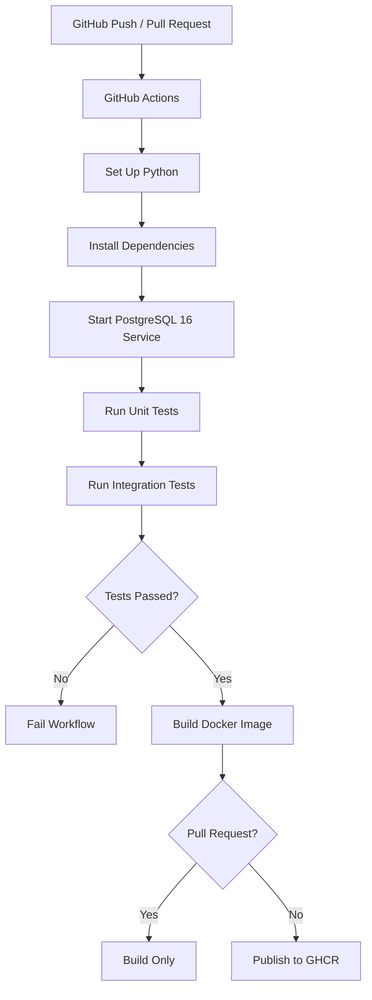

# Testing Strategy

## 1. Overview

The World Bank Data ETL Pipeline uses Pytest to verify the correctness and reliability of its ETL components.

The testing strategy is divided into two levels:

1. **Unit testing:** Verifies individual Python modules and their behaviour independently.
2. **Integration testing:** Verifies database connectivity, PostgreSQL loading operations, UPSERT behaviour and transaction handling against a real PostgreSQL instance.

The objective is to identify errors before data is persisted and ensure that the pipeline behaves consistently across local and CI/CD environments.

## 2. Testing Technology

| Component | Technology |
|---|---|
| Testing framework | Pytest |
| Coverage reporting | pytest-cov |
| Database testing | PostgreSQL |
| Database driver | psycopg2 |
| Test isolation | Dedicated integration-test table |
| Automated execution | GitHub Actions |

## 3. Test Project Structure

```text
tests/
├── unit/
│   ├── test_config.py
│   ├── test_extract.py
│   ├── test_logger.py
│   ├── test_pipeline.py
│   ├── test_transform.py
│   └── test_validate.py
│
└── integration/
    └── test_load_integration.py
```

## 4. Unit Testing

Unit tests verify individual application components without requiring a live PostgreSQL connection.

The external dependencies of the components are isolated using test fixtures and mocks where appropriate.

### 4.1 Configuration Tests

File: `test_config.py`

Tests configuration loading and validation.

Coverage includes:

- Loading application configuration.
- Required environment variables.
- Configuration value parsing.
- Invalid configuration handling.
- Validation of configuration parameters.

### 4.2 Extraction Tests

File: `test_extract.py`

Tests the World Bank API extraction module.

Coverage includes:

- API URL construction.
- HTTP session configuration.
- Request handling.
- API response parsing.
- Pagination.
- Retry and error handling.
- Empty or invalid API responses.

HTTP interactions are tested without depending on live API availability.

### 4.3 Logging Tests

File: `test_logger.py`

Verifies application logging configuration and logger behaviour.

### 4.4 Pipeline Tests

File: `test_pipeline.py`

Tests the overall ETL execution flow.

Coverage includes:

- Successful pipeline execution.
- Component interaction.
- Validation failure handling.
- Prevention of database loading when validation fails.

### 4.5 Transformation Tests

File: `test_transform.py`

Verifies the conversion of nested World Bank API responses into structured records.

Coverage includes:

- Country and indicator field extraction.
- Year conversion.
- Numeric value conversion.
- Null observation handling.
- Invalid or missing year handling.

### 4.6 Validation Tests

File: `test_validate.py`

Verifies data quality rules before database loading.

Coverage includes:

- Required field validation.
- Observation year validation.
- Negative value checks.
- Duplicate business-key detection.
- Valid and invalid record handling.

## 5. PostgreSQL Integration Testing

File: `tests/integration/test_load_integration.py`

Integration tests verify the interaction between the Python loading implementation and an actual PostgreSQL database.

Unlike unit tests, these tests require a running PostgreSQL instance.

### 5.1 Test Database Configuration

Integration tests use a dedicated table:

`public.world_bank_observations_test`

The integration fixture:

1. Checks whether database integration testing is enabled.
2. Loads the database configuration.
3. Creates the dedicated test table.
4. Provides the database settings to the tests.
5. Drops the dedicated table after the test session.

A separate table is used to avoid modifying the main application observation table.

### 5.2 Test Isolation

Before each test, the test table is truncated and its identity counter is reset.

This ensures that each test starts with a clean table and does not depend on records inserted by previous tests.

The test table is cleaned up after the test session.

### 5.3 Integration Test Cases

| Test | Purpose |
|---|---|
| Database connection | Verifies PostgreSQL connectivity |
| Insert record | Verifies successful record insertion |
| UPSERT update | Verifies updates to existing observations |
| Repeated load | Verifies duplicate prevention |
| Transaction rollback | Verifies rollback after an exception |

### 5.4 UPSERT Verification

The integration tests verify the composite conflict key:

`country_code + indicator_code + year`

When an observation with an existing key is loaded again, the existing record is updated rather than duplicated.

### 5.5 Transaction Rollback Verification

The rollback test intentionally raises an exception inside a database transaction.

It verifies that:

- The transaction is rolled back.
- Uncommitted changes are not retained.
- The connection context handles the exception correctly.

## 6. Running Tests Locally

### Prerequisites

- Python 3.10
- Project dependencies installed.
- Docker Desktop for PostgreSQL integration tests.

Activate the virtual environment:

```powershell
.\.venv\Scripts\Activate.ps1
```

Set the Python source path:

```powershell
$env:PYTHONPATH = "src"
```

### 6.1 Run Unit Tests

```powershell
python -m pytest tests/unit -v
```

Unit tests do not require a live PostgreSQL database.

### 6.2 Run Integration Tests

Start the PostgreSQL container:

```powershell
docker compose up -d postgres
```

Enable integration tests and configure the host connection:

```powershell
$env:RUN_DB_INTEGRATION_TESTS = "1"
$env:DB_HOST = "localhost"
$env:DB_PORT = "5433"
$env:PYTHONPATH = "src"
```

Run integration tests:

```powershell
python -m pytest tests/integration -v
```

The host port `5433` is used because the Docker Compose PostgreSQL service maps host port 5433 to container port 5432.

### 6.3 Run All Tests

```powershell
python -m pytest tests/unit tests/integration -v
```

### 6.4 Generate Coverage Report

```powershell
python -m pytest tests/unit tests/integration -v --cov=worldbank_etl --cov-report=term-missing
```

The coverage report displays the measured coverage of the application modules and identifies lines not covered by tests.

## 7. Continuous Integration Testing

The GitHub Actions workflow automatically runs tests when changes are pushed to the main branch or submitted through a pull request.

### CI Testing Sequence



### PostgreSQL Service in CI

GitHub Actions provisions a PostgreSQL 16 service container for integration tests.

The workflow configures:

- Database name: `worldbank_etl_test`
- Database user: `test_user`
- Dedicated test credentials.
- PostgreSQL health checks.
- Integration testing enabled through `RUN_DB_INTEGRATION_TESTS=1`.

This allows database integration tests to execute in an isolated CI environment without relying on a developer's local database.

### Test Execution and Publishing

The workflow runs unit and integration tests before the Docker publishing steps.

If tests fail, the workflow stops and the Docker image is not published.

For pull requests, the Docker image is built without being published.

For pushes to the main branch and version tags, the image is published to GitHub Container Registry after successful tests.

## 8. Testing Results

The project has previously passed:

- 28 unit tests.
- 5 PostgreSQL integration tests.
- GitHub Actions unit and integration testing.
- Docker image build and GHCR publishing.

These are recorded project results, not a guarantee of the outcome of every future test run.

## 9. Testing Considerations

The current testing strategy provides coverage for the main ETL components and PostgreSQL loading behaviour.

Potential future improvements include:

- Additional API contract tests.
- Tests for larger extraction datasets.
- Performance and load testing.
- More detailed data quality edge cases.
- Database migration testing.
- Automated test coverage thresholds.

## 10. Summary

The testing approach combines isolated unit tests with real PostgreSQL integration tests.

This helps verify both individual ETL components and their interaction with the database.

Automated execution through GitHub Actions ensures that changes are tested before Docker images are published, providing an additional reliability check for the project.